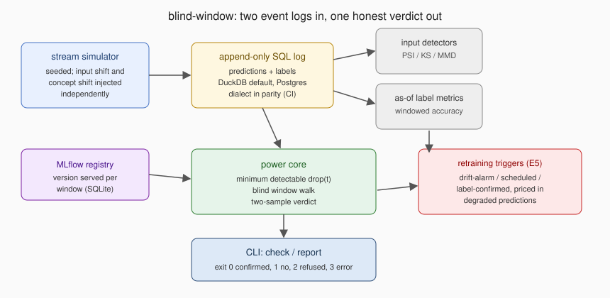
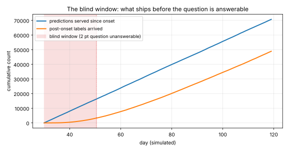

# blind-window

**Quantifies what production monitoring cannot know yet: given a label delay distribution and a traffic rate, the smallest accuracy drop confirmable today, and the count of predictions served before any verdict is possible.**

<!-- ci-badge: inserted by make set-handle -->

A drift detector fires on inputs. The labels that would prove harm arrive weeks later. At decision time, no quantity of monitoring data separates harmless covariate shift from a live regression. The only honest output is the size of the regression that is still invisible, and this tool prints that instead of an alert.

Three questions this answers that a monitoring dashboard does not:

1. If accuracy dropped the day the alarm fired, on what date could anyone prove it, at a stated alpha and power?
2. How many predictions ship between the onset and that date, at this traffic rate and this label delay?
3. When the input alarm fires, what are the odds it is pointing at real harm, at the base rate of real regressions this system actually sees?

## The numbers this repository leads with

On the committed default stream (800 predictions per day, lognormal label delay with a median delay 21 days), a model regression beginning on day 30 is **blind for 20.5 days**: the 2 point question the operator needs answered is not answerable **until day 50.5**, and the model serves **16,261 predictions before** that date. Nothing in the monitoring stack shrinks this. It is arithmetic about labels that do not exist yet.

The input-side alarm is not the answer. Across the E1 grid, worst-feature PSI shows a **correlation of -0.001** with realized accuracy loss. A stream can show a **PSI of 1.30** while losing nothing, and a stream with no detectable input movement can be **losing 4.50 points**. At a realistic **prevalence of 10%**, the alarm runs at a **precision of 20.0%** and a **recall of 50.0%**.

Credibility line: **147 tests**, **98.5% line coverage**, **6 queries per dialect** executed on every run, and every figure in this document re-measured by `make verify`. Breaking any number here fails the build, and CI proves the checker by breaking one on purpose.

## Quickstart

Prerequisites: Python 3.11 or newer.

```bash
pip install -e ".[dev]"
make demo      # simulates the default stream, asks on day 44, prints the refusal
make verify    # lint + tests + experiments + receipts, offline, no network
```

`make demo` reproduces the headline refusal:

```text
REFUSED: inside the blind window for a 2 point drop.
  labels arrived for 1211 post-onset predictions; the smallest confirmable drop today is 3.13 points.
  earliest answerable: day 50.5; predictions served before then: 16261.
  model version at risk: v1
```

## What is confirmable, and when (E2, E3)

The tool walks the days after onset, recounting both maturing samples, and reports the minimum detectable drop at the operating point (alpha 0.05, power 0.80, one-sided).

| Day after onset | Smallest confirmable drop |
| --- | --- |
| day 1 | nothing: no post-onset labels have arrived, there is no number |
| day 7 | **9.93 points (day 7)**, nothing smaller |
| day 30 | **1.39 points (day 30)** |

Traffic buys less than it promises: multiplying the rate 16x shrinks the **window by 4.20x**, because the delay distribution, not the volume, gates when labels exist.

The exposure is the headline, not the delay: the blind window is also **16,261 predictions before** the earliest verdict, every one served to a user by a model nobody can yet convict or acquit.

## The alarm and the harm are different quantities (E1, E4)

The simulator injects input shift and concept shift independently: a covariate move orthogonal to the concept (visible, harmless) and a concept rotation (invisible, harmful). Across the grid, the PSI score and the realized drop are unrelated (a **correlation of -0.001**). The detector **alarmed on 4 of 10 harmless streams** (the two largest shift magnitudes), and raised **0 alarms on the 6 silently harmful streams**.

Priced at base rates (E4): with a **prevalence of 10%** of monitoring periods containing a real regression, and the generous assumption that half of real regressions also move the covariates, the alarm achieved a **precision of 20.0%**. Four out of five alarms point at nothing, and the action attached to an alarm is a retrain. The measured zero on silent regressions is not zero: the sample supports only "the silent catch rate is **below 22.1%**" at 95% confidence.

## What each retraining trigger costs (E5)

Three policies on identical streams over a 100 day horizon, only day-by-day observable data, best-case retrains so the differences belong to the triggers:

| Trigger | Degraded predictions served | Wasted retrains | Regressions never fixed |
| --- | --- | --- | --- |
| drift alarm | **397,464 degraded predictions (drift triggered)** | 15 | **leaves 15 of 30 real regressions** serving past the horizon |
| schedule | **187,258 degraded predictions (scheduled, every 30 days)** | **150 wasted retrains** | 0 |
| label confirmed | **383,157 degraded predictions (label confirmed)** | 0 | 0 |

The uncomfortable row is the last one. The honest trigger nearly ties the broken one on exposure inside this horizon, because the blind window taxes every label-confirmed decision. The difference is what happens after the horizon: the drift trigger **missed 15 of** the regressions entirely, and their exposure grows without bound. The schedule buys its lower exposure at a price with an exchange rate: **1,305 degraded predictions avoided** per wasted retrain, which is only worth paying when a retrain costs less than that many degraded answers. ADR-004 picks the default and prices the other two.

## The bugs the measurement found

**The as-of accuracy query convicted healthy cohorts.** The first version matched labels inside `CASE WHEN p.predicted = l.y_true`, so every unlabeled row fell to the ELSE branch and counted as wrong. On the committed war-story scenario, the day-30 cohort had **only 28 labels arrived** and the broken query **reported 0.0518 accuracy**, a **55.5 point phantom** gap below the same cohort's labeled-only accuracy. Latency read as collapse, which is precisely the confusion this repository exists to remove. The fix treats unlabeled as NULL; the regression test recomputes every day from the arrays, a companion test reconstructs the broken query and asserts the detection detects it, and the collector re-measures all three figures from `fixtures/scenarios/warstory.json` on every verify. See the fix commit and `tests/test_store.py`.

**Early labels are not a sample, they are a selection.** With label delay coupled to case difficulty (E3b), the day 7 labeled accuracy for the post-onset cohort reads **11.93 points too high**, because easy cases return first and easy cases are the ones the model gets right. The bias exists before any test is run and no sample size fixes it. ADR-005 carries the boundary.

## Architecture



The diagram is a committed SVG with intrinsic dimensions; edit it directly.

## Evidence



The curve is rendered by `tools/render_evidence.py` from the same SQL the CLI report prints, and the SVG is byte-stable, so CI diffs it like a fixture. The captured refusal is committed verbatim at `docs/evidence/report-day44.txt` with its exit code.

## The fixture

One committed default scenario (`fixtures/scenarios/default.json`): **95,589 predictions over** the horizon, a harmless covariate shift on day 18, a real concept regression on day 30. The awkward cases are deliberate: the harmless shift fires the alarm before the real harm begins, so on day 18 a dashboard reader sees an alert, watches accuracy hold (the shift costs nothing), relaxes, and is then blind to the regression that follows. Experiments build their grids from seeded variants; every stream is reproducible from its scenario JSON alone.

## What this repository cannot measure

- **Real label delay distributions.** The delay here is configured, not observed. In production the delay is itself censored: a label that has not arrived is indistinguishable from a label that never will. ADR-005 names what measuring this on real traffic requires.
- **Real drift.** Injected shifts are clean by design so ground truth exists. Real covariate movement is messier and sometimes correlated with harm; E1 measures the designed world, not yours, and says so in its grid note.
- **Retraining quality.** E5 grants every policy a best-case retrain. Costs of a bad retrain land on all three triggers and are out of scope (the Pivot).
- **Anything about a specific model family.** The deployed model is a fixed linear scorer. The arithmetic consumes only correctness bits and timestamps, which is why it transfers; the simulator's accuracy levels do not.

## Layout, exit codes, reproduction

```text
src/blind_window/      clock, scenario, simulator, detectors, power core, store, policies, cli
sql/duckdb/ sql/postgres/   the six committed queries, one file per dialect
experiments/           e1 to e5 plus run_all.py
tools/                 collect_metrics, check_numbers, check_durations, prove_checker, evidence
tests/                 147 tests named as sentences
fixtures/scenarios/    the committed default stream
docs/                  adr/, experiments/ (committed measurements), evidence/, metrics.json
```

Exit codes, and the distinction is the deliverable:

| Code | Meaning |
| --- | --- |
| 0 | Regression confirmed at the stated confidence; magnitude and window printed. |
| 1 | No regression at this confidence. The tool worked; the answer is no. |
| 2 | **Refused: inside the blind window.** Prints the earliest answerable date and the predictions shipped before it. |
| 3 | The tool could not answer. Never conflated with code 1. |

`make` returns its own code for a failed recipe, so `make demo` prints the tool's exit code and returns success; branch on the `blind-window` script, not on make.

`make verify` runs lint, the suite, every experiment, and the receipts: `tools/collect_metrics.py` re-measures each figure into `docs/metrics.json`, and `tools/check_numbers.py` fails the build if any document quotes a figure the code no longer produces. It matches anchor phrases rather than bare digits (`"{} tests"`, value substituted), so a stale count is caught even when the same digits appear elsewhere, and it reverse-scans for numbers nothing re-measures. A coverage floor of 95 percent is enforced in CI, and `tools/check_durations.py` sweeps every tracked markdown file so no wall-clock duration is ever published as a result.

## Stack

| Technology | Role here | Why this one |
| --- | --- | --- |
| DuckDB | the default engine for the append-only log | time-windowed SQL over two event streams is the natural shape; runs in-process, so `make verify` stays offline |
| PostgreSQL | the second dialect, hand-written per query | the parity CI job executes all six queries on a real `postgres:16` service container and asserts row-for-row equality with DuckDB on the same fixture; the job is required, not advisory |
| SQL window functions | deciles, cumulative shares, as-of joins | the queries are the interesting part, so they live in committed .sql files with declared output columns, not in Python strings |
| MLflow (SQLite backend) | model registry | a retraining policy is meaningless without a record of which version served which window; the registry tags each version with its serving span and trigger |
| SciPy, NumPy | power arithmetic and detector statistics | the minimum detectable drop is a bisection over the two-sample normal approximation; MMD needs a permutation null |
| pytest, Ruff, GitHub Actions | suite, lint, CI | time-dependent tests take an injected clock; nothing in the library reads the wall clock or sleeps |

ADRs, in the order a reviewer should read them:

1. [ADR-001: a simulated stream rather than a public monitoring dataset](docs/adr/ADR-001-simulated-stream.md)
2. [ADR-002: PSI as the default input detector, and where it loses](docs/adr/ADR-002-default-input-detector.md)
3. [ADR-003: what "confirmed" means, and why monitoring needs its own operating point](docs/adr/ADR-003-what-confirmed-means.md)
4. [ADR-004: the retraining trigger, priced](docs/adr/ADR-004-retraining-trigger.md)
5. [ADR-005: the boundary, label delay is itself censored](docs/adr/ADR-005-boundary.md)

## The Pivot

Out of scope: an automated rollback controller. The trigger condition for building one is exit code 0 arriving while traffic is still being served, and the reason it is not built is the repository's own finding: inside the blind window an automated rollback would act on exactly the evidence this tool proves insufficient. The decision stays with a human on purpose.

Future work, in order: an estimator for the delay distribution from partially arrived labels (a survival model, which turns ADR-005's boundary into a feature); per-segment blind windows, since a segment with slow labels can hide a regression the aggregate window has already cleared; importing real prediction logs through the same two-table schema; a cost model that prices the schedule trigger against a stated retrain cost instead of an exchange rate.
